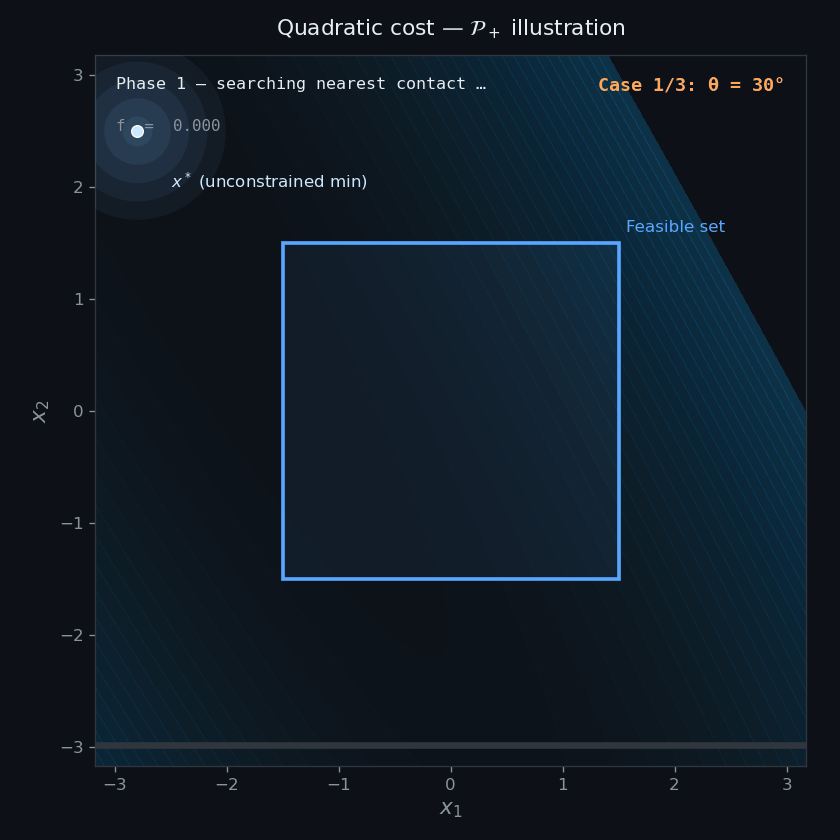

## Quick start

This project uses the `pixi` tool for dependency management and convenient run scripts (optional).

Installation (pixi):

```bash
# Install pixi (optional)
curl -fsSL https://pixi.sh/install.sh | bash
```

Run benchmarks:

```bash
# Reporduce paper randomized box QPs benchmark
pixi run benchmark-box > box_results.txt
pixi run python benchmarks/plot_benchmarks.py box_results.txt

# Reporduce paper DCM MPC benchmark
pixi run benchmark-lipm > lipm_results.txt
pixi run python benchmarks/plot_lipm_benchmark.py lipm_results.txt

```




## License

BSD3 License 

---


## Maintainers

<table align="left">
    <tr>
        <td><a href="https://github.com/mebbaid"></a></td>
        <td><a href="https://github.com/mebbaid">👨‍💻 @Mohamed Elobaid</a></td>
    </tr>
</table>

